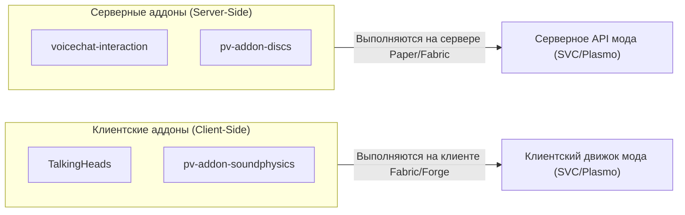
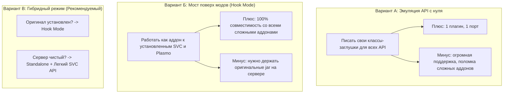
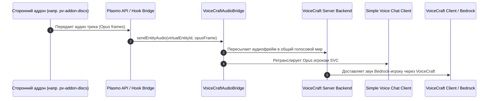

# Исследование совместимости VoiceCraft.Java с аддонами Simple Voice Chat и Plasmo Voice

## 1. Введение и цели исследования

Цель данного исследования — определить оптимальную стратегию интеграции сторонних аддонов и плагинов для **Simple Voice Chat (SVC)** и **Plasmo Voice (PV)** в экосистему **VoiceCraft.Java**.

Ключевые вопросы:
1. Как устроены и как функционируют аддоны для обоих голосовых модов?
2. Насколько обширны их официальные API и целесообразна ли их полная эмуляция «с нуля»?
3. Возможно ли работать «поверх» установленных модов (в качестве моста) или загружать их как библиотеки?
4. Как организовать кросс-клиентскую маршрутизацию звука и событий (чтобы кастомный звук или микрофонное событие одного мода было доступно всем остальным, включая Bedrock/VoiceCraft клиентов)?

---

## 2. Классификация аддонов: Клиентские vs Серверные

Все дополнения для голосовых чатов разделяются на две принципиально разные категории:



### 2.1. Клиентские аддоны (Client-Side)

> [!NOTE]
> **Примеры из исследования:**
> - [`TalkingHeads`](file:///C:/Users/alpha/Documents/Shita/TalkingHeads) — анимация размера и формы головы говорящего игрока.
> - [`pv-addon-soundphysics`](file:///C:/Users/alpha/Documents/Shita/pv-addon-soundphysics) — акустическая реверберация и окклюзия через Sound Physics Remastered.

#### Механизм работы:
* Выполняются **исключительно на клиенте игрока** (Fabric / Forge / NeoForge).
* Перехватывают локальный аудиопоток до воспроизведения или после захвата микрофона:
  * В **SVC**: подписываются на события `ClientReceiveSoundEvent` (для чужих звуков) и `ClientSoundEvent` (для своего микрофона).
  * В **Plasmo Voice**: используют `@Addon`, `@InjectPlasmoVoice` и слушают события `AlSourceWriteEvent`, `AudioCaptureProcessedEvent`.
* **Статус совместимости с VoiceCraft.Java:**
  * ✅ **Уже работают «из коробки»**. Поскольку VoiceCraft.Java на уровне сетевых протоколов полностью эмулирует серверы SVC и Plasmo Voice, клиентские моды подключаются штатно, получают Opus-пакеты и вызывают все зарегистрированные клиентские события.

---

### 2.2. Серверные аддоны (Server-Side)

> [!IMPORTANT]
> **Примеры из исследования:**
> - [`voicechat-interaction`](file:///C:/Users/alpha/Documents/Shita/voicechat-interaction) — передает уровень громкости микрофона в игровую механику (триггерит Sculk Sensor и привлекает Warden).
> - [`pv-addon-discs`](file:///C:/Users/alpha/Documents/Shita/pv-addon-discs) — транслирует кастомную музыку (YouTube, файлы, радио) в мир через пластинки и козьи рога с помощью LavaPlayer.

#### Механизм работы:
* Выполняются **на сервере** (Paper / Spigot / Fabric Server).
* Ищут официальное серверное API соответствующего голосового мода при запуске:
  * **Simple Voice Chat:** запрашивает `BukkitVoicechatService` через стандартный Bukkit `ServicesManager`:
    ```java
    BukkitVoicechatService service = Bukkit.getServicesManager().load(BukkitVoicechatService.class);
    service.registerPlugin(new MyVoicePlugin());
    ```
    Затем аддон ожидает вызов `plugin.initialize(VoicechatServerApi)` и регистрирует обработчики (`MicrophonePacketEvent`).
  * **Plasmo Voice:** использует загрузчик `PlasmoVoiceServer.getAddonsLoader()`, инжектит `PlasmoVoiceServer`, оперирует `ServerSourceLineManager` и передает аудио через `AudioFrameProvider` / `AudioSender`.

---

## 3. Сравнительный анализ API: Simple Voice Chat vs Plasmo Voice

| Критерий | Simple Voice Chat API (`de.maxhenkel.voicechat:voicechat-api`) | Plasmo Voice API (`su.plo.voice:api` + `su.plo.slib`) |
| :--- | :--- | :--- |
| **Объем кодовой базы** | **~55 файлов** (компактный и изолированный) | **~120+ файлов** (крупная многомодульная экосистема) |
| **Внешние зависимости** | Отсутствуют (чистый Java SE интерфейс) | Зависит от `su.plo.slib` (собственный слой абстракции над платформами, командами и трансляцией), ToML, Koin DI |
| **Сложность эмуляции с нуля** | 🟢 **Низкая** (~5–7 классов для покрытия 95% аддонов) | 🔴 **Высокая** (требует эмуляции внутренней инфраструктуры `slib`) |
| **Ключевые точки входа** | `BukkitVoicechatService`, `VoicechatServerApi`, `OpusDecoder`, `MicrophonePacketEvent`, `LocationalAudioChannel` | `PlasmoVoiceServer`, `ServerSourceLineManager`, `ServerSourceLine`, `VoiceServerPlayerManager`, `AudioSender` |
| **Типичные сценарии аддонов** | Перехват микрофона (`voicechat-interaction`), воспроизведение аудиофайлов/ботов (`voicechat-broadcast`) | Кастомные пластинки/рога (`pv-addon-discs`), интеграции со скульком, веб-плееры |

---

## 4. Анализ вариантов интеграции



### Вариант А: Полная реимплементация API с нуля (In-House Emulation)
* **Для SVC:** очень практично. API простое, пишется быстро.
* **Для Plasmo:** нецелесообразно писать с нуля все внутренности `slib`, так как любое обновление Plasmo приведет к расхождению сигнатур и падению `NoSuchMethodError`.

### Вариант Б: Работа поверх официальных модов (Hook / Addon Bridge)
* VoiceCraft.Java компилируется как аддон (`VoicechatPlugin` и `@Addon`).
* Если на сервере установлен `PlasmoVoice.jar`, VoiceCraft.Java мягко внедряется в него, перехватывает звук от `pv-addon-discs` и транслирует его в VoiceCraft Audio Bridge.
* **Результат:** 100% совместимость с тяжелыми аддонами (LavaPlayer, кастомные источники звука, базы мутов) без дублирования функционала.

### Вариант В: Универсальная гибридная архитектура (Dual-Mode) — 🏆 Рекомендуемый выбор
* **Режим 1 (Standalone):** Если сервер чистый (моды не установлены), VoiceCraft.Java сам держит порты и предоставляет легковесный `BukkitVoicechatService` (для работы `voicechat-interaction` и базовых аддонов).
* **Режим 2 (Bridge / Hook):** Если администратор ставит оригинальный `PlasmoVoice` или `Simple Voice Chat`, VoiceCraft.Java не занимает их порт, а регистрируется в них как официальный мост, объединяя звук между ними и VoiceCraft backend.

---

## 5. Архитектура и трансляция звука



---

## 6. Предлагаемая структура проекта

```text
VoiceCraft.Java/
 ├── modules/
 │    ├── core                                      # Ядро протокола VoiceCraft, UDP-релеи, локализация
 │    ├── adapter-api                               # Внутренняя шина VoiceCraftAudioBridge & AudioSink
 │    │
 │    ├── adapter-simplevoicechat-protocol          # Сетевой кодек протокола SVC (UDP/TCP)
 │    ├── adapter-simplevoicechat-api               # [НОВЫЙ] Легкий встроенный эмулятор SVC API
 │    │    ├── BukkitVoicechatServiceImpl.java
 │    │    ├── VoicechatServerApiImpl.java
 │    │    ├── OpusDecoderImpl.java
 │    │    └── SimpleEventDispatcher.java
 │    │
 │    ├── adapter-plasmo-protocol                   # Сетевой кодек протокола Plasmo Voice
 │    ├── adapter-plasmo-bridge                     # [НОВЫЙ] Мост-коннектор к официальному Plasmo API
 │    │    └── PlasmoVoiceHookAddon.java
 │    │
 │    ├── paper                                     # Paper плагин (инициализирует Standalone или Hook)
 │    ├── velocity & bungeecord                     # Прокси-слой
 │    └── fabric                                    # Fabric мод
```

---

## 7. Пошаговый план внедрения

```carousel
### Шаг 1: Создание `adapter-simplevoicechat-api`
- Подключение зависимости `de.maxhenkel.voicechat:voicechat-api`.
- Реализация `BukkitVoicechatService` и регистрация в `Bukkit.getServicesManager()`.
- Реализация `MicrophonePacketEvent` при получении входящих пакетов от игроков.
- Предоставление программного `OpusDecoder` (через чистую Java Concentus / нативы).
<!-- slide -->
### Шаг 2: Верификация первого серверного аддона
- Тестирование с плагином [`voicechat-interaction`](file:///C:/Users/alpha/Documents/Shita/voicechat-interaction).
- Проверка срабатывания ванильного события `VOICE_GAME_EVENT` (реакция Вардена и Скалк-сенсоров на голос).
- Проверка реакции на голос от всех клиентов (SVC, Plasmo, VoiceCraft Bedrock).
<!-- slide -->
### Шаг 3: Реализация Plasmo Hook / Source Line Bridge
- Подключение зависимости `su.plo.voice:server`.
- Реализация перехвата линий вещания `ServerSourceLine` / `AudioSender`.
- Тестирование с плагином [`pv-addon-discs`](file:///C:/Users/alpha/Documents/Shita/pv-addon-discs) (проигрывание музыки с дисков).
<!-- slide -->
### Шаг 4: Кросс-клиентская трансляция кастомных источников
- Связывание виртуальных источников (`LocationalAudioChannel` и `ServerProximitySource`) с сущностями VoiceCraft.
- Обеспечение одновременного воспроизведения звука с кастомных источников для всех подключенных типов клиентов.
```
